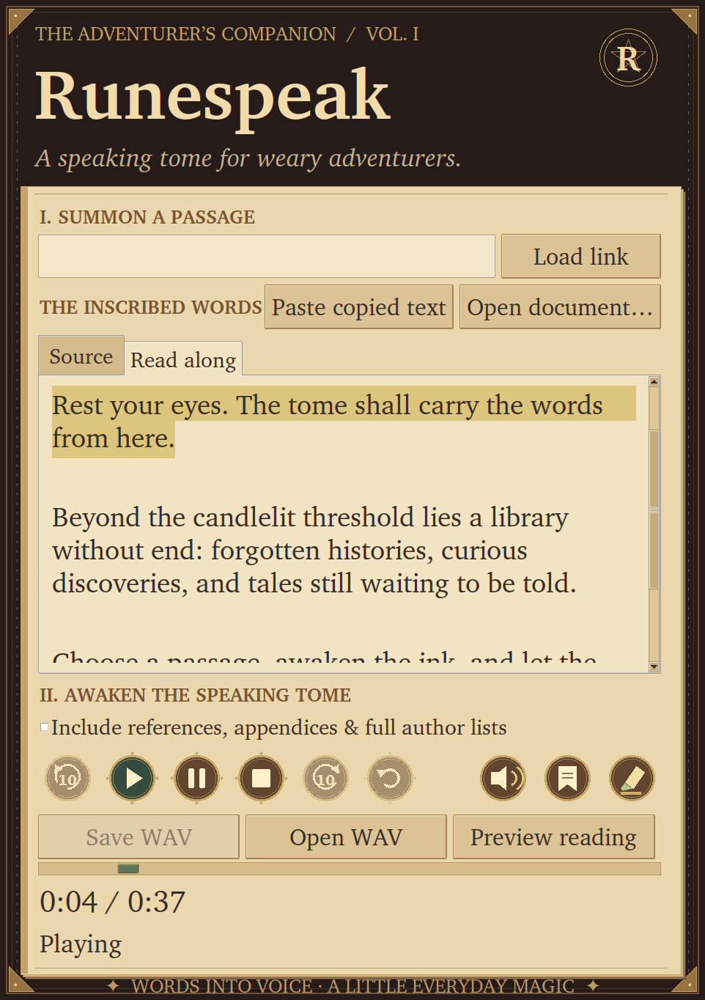

# Runespeak Lite

**Alpha 0.1.0a1.** GitHub pushes run tests and build downloadable artifacts. Releases are prepared manually as unpublished alpha drafts; see [the release guide](docs/RELEASING.md).

A small native Linux narrator using **Phonon 31M English directly**, without Ollama or a cloud speech service.

## Install the Linux alpha

Download the `amd64.deb` asset from the alpha release (when available) on Ubuntu 24.04+ or Debian 12+:

```bash
sudo apt install ./runespeak-lite_0.1.0~alpha1_amd64.deb
```

Open **Runespeak Lite** from Applications and pin it to your dock. First launch shows a setup window while downloading locked dependencies; Phonon downloads on first speech generation. Internet is needed for these initial downloads, then narration runs locally. The package needs no source checkout or uv. This alpha targets x86-64 Linux; Windows is planned later.

## The speaking tome

Runespeak wears a stitched leather cover, brass corner plates, layered parchment, an arcane seal, and warm serif type. It uses desktop-scaled point fonts and opens at a size based on the display. The minimum window reserves space for the inscription editor, timer, and controls; familiar playback labels stay visible. The artwork is drawn locally with Tk Canvas and SVG, with no new runtime dependencies or external artwork downloads.



## Read without switching windows

Keep Runespeak Lite open, then use either workflow:

- **Any app:** highlight text, press **Ctrl+C**, then **Super+Shift+R**. Runespeak reads the copied text. The integration installer below registers this shortcut on GNOME; other desktops can assign the same command manually.
- **Firefox:** highlight text and right-click **Read selection with Runespeak**, or press **Alt+Shift+R**. The extension sends the actual selection, including text on logged-in pages, rather than fetching the URL. Its toolbar popup also offers Pause, Play / Resume, Stop, and Restart.

These actions only work while Runespeak is open. They do not launch the app, watch the clipboard, or speak merely because you highlight something. A new read request during generation/loading returns a message to stop the current job first; a new request during playback replaces that playback.

## Comfortable narration

Raw HTTP(S), `www`, common bare-domain URLs, and DOI links are spoken as **“there is a URL here”**. Descriptive Markdown link labels stay readable without spelling out their destinations.

By default, standalone **References / Bibliography / Works cited / Appendix / Appendices** headings cause that section to be replaced with a short announcement. Clearly bounded Markdown sections can resume at a following heading; plain-text reference sections generally continue to the end or a recognizable concluding/acknowledgements heading. Three or more consecutive citation-style entries with author/year and publication/link evidence are also abbreviated. Ordinary bullet points, numbered arguments, isolated citations and sentences discussing references remain intact. Clear standalone author lists with at least seven names retain the first three and “additional authors.” Dense multi-line author/affiliation blocks immediately before a paper’s Abstract are also abbreviated.

Click **Preview reading** to inspect the exact spoken text and a cleanup summary before generating. Check **Include references, appendices & full author lists** to hear those sections. URLs are still abbreviated in this mode. Cleanup is conservative and heuristic: ambiguous references or author lists may remain, and a genuine standalone heading named References/Appendix will be treated as such. The editor always retains the complete source for review and manual edits. Saved JSON metadata includes both original and spoken text; timers use the cleaned narration. Previously generated audio must be regenerated for these changes to apply.

## Moving through a narration

- Use the **−10 / +10 seals**, or **Alt+Left / Alt+Right**, to move ten seconds within generated audio. Seeking keeps Pause state and does not change the saved WAV. During synthesis, forward seeking stops at the end of audio generated so far.
- To start at arbitrary text, **highlight the starting words** in Source or Read along, right-click, and choose **Read from selection / cursor**. With no selection, right-click at the desired position. **Ctrl+Enter** performs the same action using the selection/cursor.
- The **bookmark seal** opens the same navigation menu, including **Previous heading**, **Next heading** and **Jump to heading** when explicit headings are present. Wikipedia headings and Markdown `#` headings are supported; pages/files without preserved headings show no detected headings.
- Read from here and heading jumps generate a fresh narration from that point onward, cancelling an unfinished job first. The full Source and Read along documents remain intact, including earlier passages and headings. Select earlier text or a previous heading to return; audio is regenerated from that point. Read-along jumps use the cleaned spoken text you selected, not guessed word timestamps.
- Newly saved WAV sidecars restore source text and section timings when reopened. Older WAVs without text/timing metadata support ±10-second seeking but cannot offer aligned text or heading jumps.

Wikipedia pages use prose extraction: infoboxes, tables, navigation, edit links, citation markers, reference sections, external-link directories and works/publication catalogs are omitted. Article paragraphs, headings and relevant prose lists remain. This intentionally does not narrate the removed tables/catalogs even when full-reference reading is enabled. Reload a previously loaded Wikipedia link and regenerate audio to apply the cleanup.

## Choose your narrator

Click the small **narrator seal** (speaker icon) next to the highlighter. The compact menu offers the original voice, Easton, Freya, Miles and Zoey; **Character voices** includes fantasy narrators, and **All English voices** groups the complete 37-voice catalog alphabetically.

Choose a voice, then use **Preview selected narrator** for a short sample. Stop playback/generation before previewing; previews leave the document and completed narration unchanged. The first use of a named voice downloads its voice assets through Phonon. Cached models and voices work offline; an uncached selection needs network access. Selecting a voice does not interrupt existing narration. Press Play again after generation finishes to regenerate in the new voice.

The selected voice is remembered in `~/.config/runespeak-lite/preferences.json` (or `XDG_CONFIG_HOME`). Saved narration metadata records the voice used. The bundled voice catalog is a snapshot of Gradium's English catalog, rather than a network request every time the menu opens.

## Read along and highlighting

Playing a generated narration opens the **Read along** tab: the cleaned spoken text is grouped into short, sentence-sized audio passages (at most 180 characters, splitting long sentences at clauses or word boundaries). The reading pane reserves at least seven text lines when screen space permits. The current passage is highlighted in **antique gold** and scrolls into view as playback advances. **Source** keeps the complete original text editable; you can switch back to it while listening.

Click the **highlighter seal** beside the playback icons to choose antique gold, sage, rose, moonstone or lavender, or a custom color. Highlighting and automatic scrolling can be switched independently. Colors and follow options apply for the current app session. Pause holds the current highlight, restart returns to the beginning, and Stop clears it.

This is **passage-level following**, synchronized to generated section playback. The installed Phonon API does not provide word timestamps, so the app does not claim word-by-word alignment. Saved narrations now include section text and durations in their JSON sidecar; keep that file beside the WAV to restore read-along. Older WAVs without section metadata remain playable but cannot provide aligned highlighting.

## Listening time

The tome shows one **elapsed / total** timer and a playback progress bar. A `~` marks an estimated total while synthesis is in progress. Hover over the timer, or focus it with Tab, to see cumulative listening time for this sitting. Remaining time and section-position counters are not repeated in the main interface. Pauses, generation waits, and stopped playback do not add listening time. Restart/replay resets the current playhead while keeping the sitting total.

During generation, the total is labeled **approx.**: it starts at 150 words per minute and adapts to the duration of generated sections. Once generation finishes, total duration comes from the actual WAV audio. Saved WAV files also show their duration on opening. Elapsed playback is a monotonic-clock estimate, updated about ten times per second and aligned to each completed section; it is not a sample-level audio-device clock. Sitting totals are not persisted after closing the app.

## Streaming and controls

**Play** (the green triangular seal) generates narration when needed and starts playback as soon as the **first section** has been generated. Phonon generates later sections in the background. The model loads once per narration job. First use downloads model files, so it takes longer.

- **Pause** holds playback at its current position, including when waiting for the next section. Synthesis continues in the background.
- **Play** continues paused playback, replays completed narration, or generates speech if the editor text or reading options have changed. There is no separate Read aloud button. Play, Pause, Stop and Restart use illustrated brass-edged seal icons with hover/focus hints; they remain keyboard-focusable. Save WAV, Open WAV and Preview reading form a separate row below.
- **Restart** replays from the first generated section without regenerating it, even while later sections are being produced.
- **Stop** stops playback and cancels unfinished synthesis. Completed narrations remain replayable; an unfinished narration must be generated again.
- **Save WAV** becomes available when all sections have been generated, even if playback is still in progress. It saves every section in order, plus a JSON sidecar with the original text, source URL and model ID. The save dialog defaults to **Music/Runespeak** (respecting your desktop Music folder). Names come from the recording’s webpage URL, such as `distill-pub-2020-circuits-zoom-in.wav`; query strings and fragments are omitted. Pasted text uses its opening words. Existing names receive a numbered suffix instead of being suggested for overwrite. You can still choose another folder or name.
- **Open WAV** reopens a saved narration without synthesis.

The app buffers whole sections, rather than streaming individual audio frames. Very slow generation can leave a gap between sections. Temporary audio lives on disk; save it before closing or starting another narration. Playback uses `pw-play`, `paplay`, or `aplay`, in that order.

## Setup (Ubuntu / Debian)

```bash
sudo apt install python3-tk pipewire-bin poppler-utils tesseract-ocr tesseract-ocr-eng libreoffice-writer
uv sync
python3 scripts/install-desktop.py
python3 scripts/install-integrations.py --gnome-shortcut
```

The last command installs the local Firefox companion and the **Super+Shift+R** clipboard shortcut on GNOME. It preserves existing custom shortcuts and refuses to overwrite a conflicting custom binding. On KDE or another desktop, omit `--gnome-shortcut` and add a global keyboard shortcut for:

```text
/home/YOUR_USER/.local/bin/runespeak-read --clipboard
```

Press **Super**, search for **Runespeak Lite**, and open it. Pin its tome icon to the dock if desired. The installer registers the icon in your per-user icon theme, and the app embeds its own PNG icon for terminal launches. If an older generic gear is pinned, unpin it and pin the updated Runespeak entry after reopening. Close older windows and reopen the app after a code update.

The launcher and companion reference this checkout and its `.venv`; keep the folder in place, or rerun both installers after moving it. After updating dependencies, run `uv sync` and reopen the app. The app can also be launched with `uv run runespeak`. If uv chooses a Python without Tk support, use `uv run --python /usr/bin/python3 runespeak`.

### Enable the Firefox extension

The native companion is installed by `install-integrations.py`. Load the included extension separately:

1. Open `about:debugging#/runtime/this-firefox` in Firefox.
2. Click **Load Temporary Add-on…**.
3. Select **`firefox-extension/manifest.json`** from this project.
4. Keep Runespeak open, highlight webpage text, and use **Alt+Shift+R** or the selection right-click menu.

This development installation lasts until Firefox restarts. Load it again after a restart. Permanent installation in standard Firefox requires Mozilla signing; this repository does not contain a signed release. Browser shortcuts can be changed in Firefox's **Manage Extension Shortcuts** screen.

The extension uses Firefox native messaging, not an HTTP service. Browser-internal pages and other restricted pages may block shortcut selection capture; the copy-and-read shortcut is the fallback. Selection in cross-origin frames can be read with the right-click selection menu. Sandboxed Snap/Flatpak Firefox installations may not find a host installed in `~/.mozilla/native-messaging-hosts`; use a Firefox installation with user native-host support or the system clipboard shortcut. The extension itself has not been installed into your browser profile automatically.

## Documents, PDF links, images and drops

- Paste a **webpage or PDF/document URL** and click **Load link**. Extensionless PDF links such as arXiv are recognized from their file contents.
- Click **Open document…** to choose local files, or **drop files onto the parchment/editor**. Paths containing spaces are supported. Up to 20 documents can be loaded together in drop/selection order.
- Review the extracted words, then click **Play**. Loading a document does not automatically start narration.
- **PDF:** text extraction with Poppler; pages without extractable text automatically use local English OCR.
- **TXT / MD / Markdown:** plain text, with common Markdown headings, links and emphasis cleaned up.
- **DOCX / ODT:** text from paragraphs and tables. DOCX footnotes/endnotes are appended. Headers, images and formatting are not narrated.
- **DOC / RTF:** converted locally using LibreOffice with an isolated temporary profile.
- **PNG / JPEG / TIFF / BMP / WebP:** local English OCR with Tesseract. Image support reads written text; it does not describe photographs or interpret charts. For multi-frame images, only the first frame is read.
- Documents can also be opened with **Open With → Runespeak Lite** in Files. WAV files start playback; text documents load into the editor.

All extraction and OCR runs in a background worker; **Stop** cancels it. Dependencies missing on another machine produce an installation message. Drag-and-drop uses TkDND under XWayland; compositor/source-app restrictions can prevent some drops, in which case use Open document or paste a link. Dragging files from a file manager is preferred over dragging IDE tabs. Text selections can still be sent through the Firefox extension or clipboard shortcut.

Limits: 64 MiB per document/download, 200 pages per PDF, 40 megapixels per image and 4 MB of extracted text. Individual conversion/OCR commands have a two-minute timeout. URL downloads have a 20-second socket timeout. Password-protected, corrupted or unsupported documents report an error rather than being narrated. OCR runs only on PDF pages with no text layer; it does not repair inaccurate embedded OCR. Tables, equations, references and multi-column papers may extract in an imperfect order. **Review the extracted text before listening.**

Article extraction prefers explicit body containers (including Alignment Forum / LessWrong posts), preserves paragraph and list boundaries, and keeps inline links within sentences. It recognizes article content inside React streaming containers so hidden server-rendered post bodies are not discarded in favor of navigation. URL article extraction reads returned HTML, not JavaScript-rendered content or browser login sessions. Scripts, styles and SVG drawings are stripped before extraction. Use the browser selection action for logged-in webpages. Local document narrations use the original filename for suggested WAV names in Music/Runespeak.

## Local communication and privacy

Speech generation is local. The first model load contacts upstream hosting to download/cache model files; fetching a URL contacts that website. No cloud speech account is needed.

The running app owns a Unix socket in a private per-user runtime directory, with socket permissions `0600`. Closing the app removes it. There is no HTTP/TCP listener or background daemon. Firefox grants native-host access only to this extension ID. Native commands are bounded to 1 MB. The desktop helper and extension send requests to the existing app and never start a new app window.

For command-line control while the app is open:

```bash
~/.local/bin/runespeak-read --clipboard
~/.local/bin/runespeak-read --text "Read this sentence."
~/.local/bin/runespeak-read --pause
~/.local/bin/runespeak-read --resume
~/.local/bin/runespeak-read --stop
~/.local/bin/runespeak-read --restart
```

## Model choice

Phonon **31M** English has millions of parameters, not billions, and Apache 2.0 weights. It is the checkpoint behind Ollama's `phonon:en`. The 40M weights use CC BY-NC 4.0 and are unnecessary for this English reader. No large language model is needed to read verbatim. Ollama currently lists Apple Silicon as a requirement for its Phonon package, so this app uses Gradium's native Linux `ptts` runtime with q8 weights and the selected narrator.

- [Gradium runtime and Linux installation](https://github.com/gradium-ai/xn-ptts)
- [Phonon model details and licenses](https://huggingface.co/gradium/phonon-31m-en)
- [Ollama Phonon compatibility](https://ollama.com/library/phonon)
- [Firefox native messaging documentation](https://developer.mozilla.org/en-US/docs/Mozilla/Add-ons/WebExtensions/Native_messaging)

No playback speed control, persistent reading position, tray icon or MP3 export is implemented yet.

## Opening saved audio from Files

The desktop installer registers Runespeak for WAV audio and supplies a default only where no player is already assigned. Double-click a saved WAV, or use **Open With → Runespeak Lite**. If the app is already open, the file is sent to that window; if generation is in progress, stop that job first. You can also use **Open WAV** inside Runespeak.

A Files message saying “There is no app installed for WAV audio files” describes a missing file association; it does not establish that the audio is damaged. Runespeak checks the WAV header before opening it.

## Troubleshooting and removal

Launcher errors are logged to `~/.local/state/runespeak-lite/app.log` (or your `XDG_STATE_HOME`). Audio-player errors appear in a dialog. If browser selection delivery fails, check that the current app is open and the native companion is installed. If Runespeak is generating, use Stop before submitting a replacement selection.

Remove the GNOME shortcut in Settings → Keyboard → Custom Shortcuts. Remove the Firefox extension in `about:addons` (or restart Firefox for a temporary add-on), then delete these per-user integration files if no longer wanted:

```text
~/.local/share/applications/runespeak-lite.desktop
~/.local/bin/runespeak-lite
~/.local/bin/runespeak-read
~/.local/bin/runespeak-firefox-host
~/.mozilla/native-messaging-hosts/org.runespeak.lite.json
```

## Development and verification

```bash
.venv/bin/python -m unittest discover -s tests -v
node tests/test_extension.cjs
# On a Linux desktop: include layout and playback-transition tests.
RUNESPEAK_GUI_TESTS=1 .venv/bin/python -m unittest discover -s tests -v
# Real model + native messaging + actual desktop audio (brief test narration).
.venv/bin/python scripts/smoke-desktop.py
```

The tests cover article limits and cancellation, text splitting, lossless WAV assembly, first-section playback, pause between sections, avoiding duplicate playback after assembly, direct selection delivery, native-message framing, invalid requests, and socket lifecycle. The JS checks exercise Firefox menu/shortcut handlers and error reporting using mocked browser APIs; an actual Firefox add-on load remains a separate manual check.
